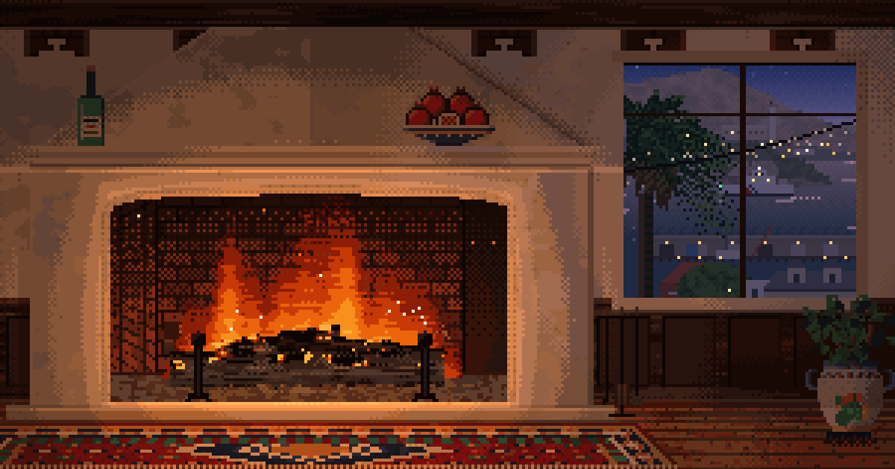

# Yule Log

An 8-bit Yule log for your phone or computer: two fireplaces whose windows show the real sky over the places they look out on.

**[yule-log.vercel.app](https://yule-log.vercel.app)**

- **Russian Hill:** a Spanish Colonial room with a plaster hood and a Persian rug, looking north over the wharf to Alcatraz and Angel Island.
- **Tahoe City:** a log cabin with a river-rock chimney, looking east across the lake to the Carson Range.

The look comes from the dioramas in Pocket Planes and in natural history museums: a strong sense of place, but one that moves with the weather and the hour.

## Using it

Press **Crackle on** for sound; browsers keep a page silent until you ask. The controls fade after a few seconds, and a tap or a mouse move brings them back. To keep it on a home screen, use **Install** where the browser offers it, or Share, then Add to Home Screen on an iPhone. Once visited, it runs offline.

| Key | Action |
| --- | --- |
| Arrow keys | Change place |
| `t` `w` `e` `d` | Step through time, sky, season, decor |
| `s` | Sound on or off |
| `f` | Full screen |

To link to a particular moment, use `#place-time-sky-season-decor`, for example [`#tahoe-sunset-clear-summer-none`](https://yule-log.vercel.app/#tahoe-sunset-clear-summer-none). The places are `mission` (Russian Hill) and `tahoe`, and `live` works in any later position. The other values are the ones the preview buttons cycle through, in lowercase, with Low fog written `lowfog`.

## What's real

Everything is worked out for the place, in its own time zone, so Tahoe gets dark at Tahoe's nightfall even if you're watching from New York.

| In the window | Source | If it's unavailable |
| --- | --- | --- |
| Sun | Calculated from the time and coordinates | Needs no network |
| Moon | Calculated, with an approximate position | Needs no network |
| Temperature, cloud, rain, snow, wind | [Open-Meteo](https://open-meteo.com/) forecast, refreshed every 15 minutes while the tab is visible | Typical weather for the season, labeled `Almanac` |
| Fog on the Bay | [NOAA visibility sensor](https://tidesandcurrents.noaa.gov/) at Pier 17, then Oakland Berth 38, then airport reports | Estimated from the forecast |
| Fog deck over the Bay's hills | Cloud height at Oakland airport, then SFO, from [weather.gov](https://www.weather.gov/documentation/services-web-api) | Estimated from the forecast |
| Fog at Tahoe | Estimated from the forecast | `Almanac` |
| Ships and sailboats | Simulated | Needs no network |

Seasons and holidays follow the calendar at the place. They change the hills, the snow and what's on the mantel. The fire stays the same in every season.

## Developing

There's nothing to install. `npm start` serves the app and prints a URL for this computer and one for a phone on the same Wi-Fi. Use it rather than opening `index.html` directly, because assets load from the site root.

The code is plain scripts sharing `window.Yule`, loaded in the order listed in `index.html`. Each file opens with a comment describing its job, and `src/app.js` is the place to start.

How a frame gets made explains most of the code:

1. A room's `paint` draws flat colour once. It knows nothing about light.
2. `src/room.js` relights those pixels every frame from the fire and the daylight, through a limited palette. That's why the light can move while the picture stays 8-bit.
3. `src/view.js` animates the window on top, using the layers a painter in `src/views/` lays down.

What will catch you out:

- **New conditions need a key.** The picture rebuilds only when `conditionKey` in `src/app.js` changes, so add any new value that affects the picture to it.
- **A new mantel item needs its light considered.** Pixels with `m.mark` at 1 or more stay in front of the flames and get less firelight. Anything that glows draws over the relit frame in `room.draw`.
- **Calm means silent.** The fire is only its crackle, and clear, cloudy, foggy and snowy skies make no continuous sound. Continuous noise belongs to wind and storms only.
- **The service worker runs only on `https:`,** so local development always sees fresh files. On the real site, returning visitors get a new version on their next load.
- **Each new script needs a tag in `index.html`.** The build inlines scripts by following those tags. Files in `assets/` are copied and cached automatically, apart from `og.png` and the `.txt` license files.

## Deploying

The site is static and hosted on Vercel. From a linked checkout, `vercel deploy --prod` runs the build and publishes `site/`.

The free Open-Meteo tier is for non-commercial use, so ads or paid features would need a paid plan. Its license requires the credit beside the conditions, so keep that visible.

## Credits

- Weather by [Open-Meteo.com](https://open-meteo.com/), under [CC BY 4.0](https://creativecommons.org/licenses/by/4.0/). Tahoe's fog is worked out from this data, not reported by it.
- Fog data from NOAA and the National Weather Service.
- [Pixelify Sans](https://github.com/eifetx/Pixelify-Sans) and [Silkscreen](https://github.com/googlefonts/silkscreen), under the SIL Open Font License. The licenses are in `assets/fonts/`.

## License

The code and art are under the [MIT License](LICENSE). The bundled fonts keep their own license, as noted under Credits.

## More

[`NOTES.md`](NOTES.md) records the design decisions and the reasons for them, the mantel calendar, and the evidence behind the fog and sunlight choices. Read it before changing how the app looks or sounds.
